# Tokencraft

A Minecraft-inspired world for Claude Code, built as a [Claude Code mod](https://code.claude.com/docs/en/plugins/mods/overview).
Claude's tool calls turn into blocks and XP. The sky follows your context window, the weather
follows your plan limits, and Claude mines beside your prompt while it works.



*Not affiliated with Mojang or Microsoft. Free and open source (MIT).*

## Install

Needs Claude Code **2.1.287** or later (`claude --version`), the release that added mods.

```bash
claude plugin marketplace add DanielPodolsky/tokencraft
claude plugin install tokencraft@tokencraft
```

Then start a new session, or run `/reload-plugins` in an open one. From inside a session it's one
command: `/plugin install tokencraft --marketplace DanielPodolsky/tokencraft`.

Update with `claude plugin update tokencraft@tokencraft`; remove with `claude plugin uninstall tokencraft@tokencraft`.

## What the world means

Everything in the band is a live reading of your session. Hover any part on Desktop for its exact numbers.

| You see | It means |
|---|---|
| ❤ **Hearts** | how much of your 5-hour plan limit is left |
| 🍗 **Hunger** | how much context is left (compacting is eating) |
| the **hotbar** | this session's blocks; the last one earned is framed, each pickup floats up as `+1` |
| the **XP bar** and level | lifetime XP, on Minecraft's own XP curve (level 30 = 1,395 XP) |
| Claude swinging a **pickaxe** | a turn is running; idle, Claude stands by |
| the pickaxe's color | your tier: wood → stone (Lv 5) → iron (Lv 10) → diamond (Lv 20) → netherite (Lv 30) |
| the **sky**: sunrise → noon → sunset → night | how full the context window is |
| a **creeper** saying `ssss… /compact` | night has fallen (context about 85% full): compact soon |
| **rain** · **thunderstorm** | 5-hour limit past 70% · past 90% |
| **snow**, the ground turning white | 7-day limit past 70% |
| a lit, smoking **furnace** | a `/smelt` focus timer is running |
| the **sign** | level, lifetime blocks, today's XP |
| `LEVEL 14!`, orbs flying into the bar | a level-up |
| a "Milestone reached!" card | a milestone (first green test run, first commit, level 10…) |






*Sunset and rain · night and the creeper · a thunderstorm · snow with the furnace lit. Each picture is
`hooks/scene.js`'s own output (`node tools/render_previews.mjs`).*

## Blocks and XP

| Claude does | You get |
|---|---|
| reads or searches a file (Read, Grep, Glob) | 🪨 stone · 1 XP |
| edits or writes a file | 🪵 planks · 2 XP |
| runs a shell command | 🧨 TNT · 1 XP |
| runs tests that pass | 💎 diamond · 10 XP |
| runs tests that fail | 💥 a creeper, no XP |
| commits | 💚 emerald · 7 XP |
| uses an MCP tool | 🔴 redstone · 1 XP |
| starts a subagent | 🥚 spawn egg · 3 XP |
| fetches or searches the web | 🟣 ender pearl · 1 XP |
| uses a skill | 📕 enchanted book · 2 XP |
| finishes a turn | 3 XP |

Each answer ends with a loot line, `+2 🪨 stone · +1 💎 diamond · +17 XP · ⬆ Level 2`. The spinner
keeps its own words and adds what the turn has mined so far: `Reading… ⛏ 4`. A level-up chimes
(with a toast in the terminal, and anywhere for a new pickaxe tier); a milestone slides a card into
the Desktop band, or toasts in the terminal; a finished `/smelt` toasts with its own chime.
`/hud sound off` silences the chimes. `/clear` is a respawn: the hotbar empties, XP stays.

In the terminal the HUD is two lines of colored text above the prompt; the animated world is the
Desktop app's.

## Commands

They run at once, even while Claude is working, and never start a Claude turn.

| Command | What it does |
|---|---|
| `/f3` | The debug screen: branch, context left, plan limits, level, this session's blocks, the furnace |
| `/smelt 25 <task>` | A focus timer: the furnace burns, the arrow fills, finishing pays 1 XP a minute. `/smelt stop` puts it out with no XP. Default 25 min, max 180 |
| `/weather` | `clear` · `rain` · `storm` · `snow` for this session; `auto` (the default) follows your plan limits |
| `/hud` | `on` · `off` · `sound on` · `sound off`; with no argument it toggles the HUD |

## Settings

One option, in `/config` (or `/plugin configure tokencraft@tokencraft`):

| Option | Default | What it does |
|---|---|---|
| `px_per_column` | `8.35` | How wide one column of the Desktop band is, in pixels. Raise it if the world stops short of the band's right edge, lower it if it's cut off |

Desktop reports the band's width in columns of its code font; the scene is drawn at
`columns × px_per_column` pixels. `/f3`'s `Band` line shows both numbers to tune by.

## What it can reach

A mod runs inside Claude Code with your permissions, so check before you trust one.
`claude plugin validate .claude-plugin/plugin.json` lists every call this one makes. It:

- reads `.git/HEAD` for `/f3`'s branch, and, in a repo that keeps a MaiOS sprint file
  (`maios/planning/sprint.local.md`), the next sprint item — `/f3` only
- keeps its save in Claude Code's plugin store (`$.store`): lifetime XP and blocks, milestones,
  prefs, the running furnace. Every session on your machine shares it, so XP from parallel sessions adds up
- plays two sounds it ships (`sounds/*.wav`, synthesized by `tools/make_sounds.py`)

It makes **no network call**, starts **no process**, never calls a model, and never approves or
blocks a tool call: it only watches them finish.

## Tested with

Claude Code 2.1.287 on macOS: the Desktop app's Code tab and the terminal. Per the
[mods docs](https://code.claude.com/docs/en/plugins/mods/overview#where-mods-run), the VS Code chat
panel and `claude -p` run the hooks (XP still counts) but draw nothing. Mod APIs may change between
releases.

## Develop

```bash
git clone https://github.com/DanielPodolsky/tokencraft
claude --plugin-dir ./tokencraft
```

To load a clone in every session, the Desktop app included, add it to `~/.claude/settings.json`
(and don't also install it from the marketplace, or it loads twice):

```json
{ "env": { "CLAUDE_CODE_PLUGIN_DIRS": "~/path/to/tokencraft" } }
```

A watched folder reloads on save in the terminal; on Desktop run `/reload-plugins`. For a release,
bump `version` in `plugin.json`: installs keep their copy until it changes.

```bash
claude plugin validate --strict .claude-plugin/plugin.json
claude plugin test
```

26 tests cover the XP curve, the tool → block map, the loot line, level-ups and milestones, the
creeper on a red test run, the HUD on Desktop (SVG) and in the terminal (text), the spinner,
`/smelt`, `/f3`, `/hud`, `/weather`, the `px_per_column` option, a `claude -p` run staying clean,
and the scene: the SVG size limit, the sky, the weather, the pickaxe swinging only while working,
loops keeping phase across redraws, one-shot effects dropping out once played, and escaped labels.
Claude Code writes the editor types `tsconfig.json` extends (`.claude-plugin/types/`, gitignored)
each time it loads the clone.

## Files

| File | Job |
|---|---|
| `.claude-plugin/plugin.json` | the manifest, with the `px_per_column` option |
| `.claude-plugin/marketplace.json` | lets `claude plugin marketplace add` find the plugin |
| `hooks/register.js` | every hook and every mods-API call |
| `hooks/blocks.js` | pure logic and the terminal HUD; no mods API, so it's testable on its own |
| `hooks/scene.js` | the Desktop world: pixel art, sky, weather and every animation, as one SVG |
| `tests/` | the hooks, commands and HUD (`tokencraft.test.ts`), the scene (`scene.test.ts`) |
| `tools/render_previews.mjs` | renders `docs/previews/*.svg` from `scene.js` |
| `tools/make_sounds.py` | synthesizes `sounds/*.wav` |

## License

MIT. Tokencraft is a fan-made, Minecraft-inspired project: its pixel art and sounds are original,
and it uses no Minecraft code, textures, fonts or audio. Minecraft is a trademark of Mojang
Synergies AB. Not affiliated with or endorsed by Mojang, Microsoft or Anthropic.
